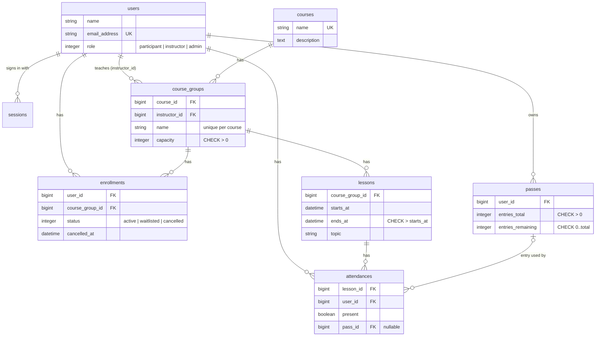

# SchoolHub

Class enrollment system for a single small school (language or dance). Participants sign up for course groups, instructors check attendance, and admins manage courses, groups, schedules, users and passes. The interface is in Polish.

Built with Rails 8.1, Hotwire, PostgreSQL and Tailwind CSS as a portfolio project.

## Features

- **Accounts:** sign up (always as a participant), sign in, password reset by email, three roles: participant, instructor, admin.
- **Courses and groups:** admins manage courses, groups (instructor + seat limit) and user roles; participants browse courses.
- **Enrollments:** seat limit protected by a row lock, automatic waitlist, cancellation promotes the first waitlisted person.
- **Emails in the background:** confirmation (seat or waitlist) and promotion emails via Active Job.
- **Schedule:** single lessons or weekly series; "Mój plan" shows each role its upcoming lessons.
- **Attendance and passes:** the group's instructor (or an admin) ticks attendance; each attendance uses at most one pass entry, and entries never drop below zero.

## Tech stack

| Area | Choice |
| --- | --- |
| Language / framework | Ruby 4.0, Rails 8.1 |
| Database | PostgreSQL |
| Frontend | Server-rendered ERB, Turbo, Stimulus, Tailwind CSS |
| Background jobs | Active Job (Solid Queue in production) |
| Auth | Rails 8 authentication generator (`has_secure_password`) |
| Tests | Minitest, fixtures, system tests with Capybara + headless Chrome |
| Quality | RuboCop (rails-omakase), Brakeman, GitHub Actions CI |

Extra gems: `bcrypt` (password hashing, required by the auth generator) and `rails-i18n` (Polish translations for built-in messages).

## Running locally

Requirements: Ruby 4.0.9 (see `.ruby-version`), PostgreSQL 14+, and Chrome for system tests.

```bash
bin/setup --skip-server   # installs gems, creates and migrates the database
bin/rails db:seed         # demo school: courses, groups, lessons, enrollments, passes
bin/dev                   # app on http://localhost:3000
```

If PostgreSQL runs on a non-default port, set `PGPORT` (for example `export PGPORT=5433`). To use another web port, run `PORT=3001 bin/dev`.

### Demo accounts

All demo accounts use the password `demo12345`.

| Email | Role |
| --- | --- |
| `admin@schoolhub.test` | Admin |
| `instruktor@schoolhub.test` | Instructor |
| `instruktorka@schoolhub.test` | Instructor |
| `uczestnik@schoolhub.test` | Participant |

In development, emails are not sent. You can preview them at `/rails/mailers`.

## Tests and checks

```bash
bin/rails test          # models, controllers, mailers
bin/rails test:system   # browser tests (headless Chrome)
bin/rubocop
bin/brakeman
```

CI runs all four on every push.

## Data model



## Design decisions

### Business rules live in models and are backed by the database

Rules important for data integrity are checked twice: a validation gives a readable error message, and a database constraint guarantees the rule even for code that skips validations (`update_column`, raw SQL, a future second app).

- Roles, enrollment statuses and seat limits have `CHECK` constraints.
- "At most one active or waitlisted enrollment per participant and group" is a **partial unique index** (`WHERE status IN (0, 1)`). Cancelled rows are excluded, so a participant can enroll again.
- `passes.entries_remaining` has `CHECK (entries_remaining BETWEEN 0 AND entries_total)`.

### Concurrency

- **Seat limit.** `CourseGroup#enroll` runs inside `with_lock` (`SELECT … FOR UPDATE` on the group row). Parallel enrollments for the same group wait for each other, so the seat count they read is always current. `test/models/enrollment_concurrency_test.rb` starts five threads competing for one seat. It fails without the lock and passes with it.
- **Attendance.** `Lesson#record_attendance` locks the lesson row, and charging a pass locks the pass row, so two people saving the same attendance sheet cannot create duplicate rows or charge twice.

### Passes are charged idempotently

`Attendance#update_presence!` only acts when the presence value changes. The first "present" takes one entry from the oldest pass with entries left and remembers that pass in `attendances.pass_id`. Unticking returns the entry, and saving the same sheet again changes nothing. A participant without entries can still be marked present: the sheet shows a "bez karnetu" badge, and the entry is not charged later.

### No service objects (yet)

The logic fits naturally on one model each: `CourseGroup#enroll`, `Enrollment#cancel!`, `Lesson#record_attendance`, `Lesson.create_weekly_series`. Following the project rule, a service class would only appear for logic that spans several models and fits none of them.

### Emails are sent from controllers, not callbacks

Model methods return what happened, for example `Enrollment#cancel!` returns the promoted enrollments, and the controller enqueues the emails with `deliver_later`. This keeps models free of side effects and makes it obvious where emails come from.

### Authorization without a gem

- Every controller requires sign-in by default (`Authentication` concern). Public pages opt out explicitly.
- Roles are checked by a small `require_role` class method (`Authorization` concern). Everything under `Admin::` inherits `require_role :admin` from `Admin::BaseController`.
- Record-level access uses scoping instead of checks after loading. Participants only find their own enrollments (`Current.user.enrollments.find`), and instructors only find lessons of their own groups (`Lesson.manageable_by(user)`). Other ids return 404, which also prevents IDOR.
- Strong parameters (`params.expect`) never permit `role` on sign up, and admins cannot change their own role.

Pundit was considered. With three roles and two record-level rules, the hand-written version is shorter and easier to follow.

### Pagination without a gem

Long lists use a small `Pagination` concern (limit/offset, about 20 lines) instead of adding Pagy or Kaminari.

### Polish UI

`rails-i18n` provides Polish translations. Its default messages agree with a neuter noun ("nie może być puste"), which is wrong for many attribute names. The app therefore uses the neutral format `"Pole: komunikat"`, for example "Nazwa grupy: to pole jest wymagane". The time zone is Europe/Warsaw, and weekly lesson series keep their local time across daylight saving changes.

## Out of scope

Online payments, multiple schools (multi-tenancy), a mobile app, chat, and an SPA with a separate API.
